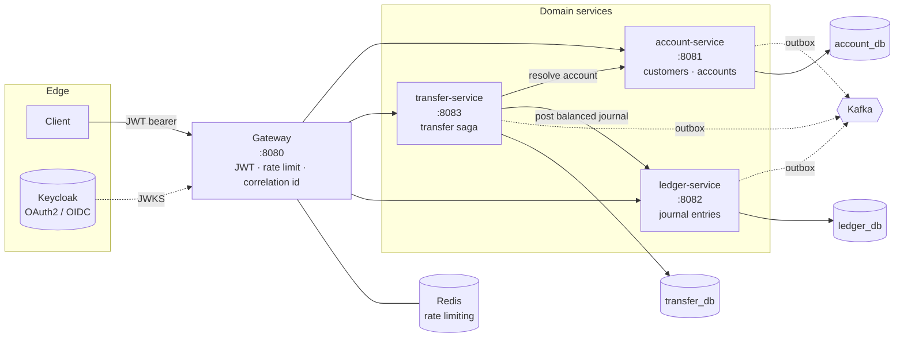

# PayForge

A double-entry payments backend built with Java 21 and Spring Boot 3: three domain services behind an API gateway, money moved by balanced journal entries, domain events published through a transactional outbox, and OAuth2 scopes enforced at every hop.


---

## What this is

Most "payment demo" projects store a balance column and add to it. That breaks the moment two callers touch the same wallet, a retry arrives twice, or an event is published for a transaction that later rolls back.

PayForge is built around the constraint that money must never be created, destroyed, or double-spent:

- **Balances are derived, never stored.** A wallet balance is the sum of the postings that touched it.
- **Every movement is a balanced journal entry.** Debits and credits are written together and must net to zero, so the ledger cannot drift.
- **A repeated request cannot charge twice.** The idempotency key is a unique database constraint, not an in-memory check.
- **A rollback cannot leave a phantom event.** Events are written to an outbox in the same transaction as the state change, then relayed to Kafka.

## Architecture



Each service owns its own PostgreSQL database and migrates it with Flyway. No service reads another's tables: the transfer service asks the account service over HTTP and asks the ledger to post through a narrow internal API.

### The path of one transfer

```
POST /api/v1/transfers          Idempotency-Key: 3f9c...
   │
   ├─ 1. gateway      validate JWT, apply the per-user rate limit, stamp X-Correlation-Id
   ├─ 2. transfer     INSERT transfer (PENDING) — unique index on idempotency_key
   ├─ 3. transfer     GET /internal/v1/accounts/{number}  → ledger code, currency, status
   ├─ 4. ledger       POST /internal/v1/journals            DEBIT alice, CREDIT bob
   │                   (rejected if the entry does not net to zero or funds are short)
   ├─ 5. transfer     UPDATE transfer (COMPLETED) + outbox row, in one transaction
   └─ 6. relay        outbox → payforge.transfer.events
```

Step 4 is idempotent on `transfer:<id>`, so a retry after an ambiguous failure returns the original entry instead of posting a second one. That is what makes the `PENDING` state safe to retry.

## Services

| Service | Port | Responsibility |
| --- | --- | --- |
| `gateway` | 8080 | Reactive Spring Cloud Gateway: JWT validation, per-subject rate limiting, correlation id propagation, CORS |
| `account-service` | 8081 | Customers and accounts; allocates account numbers; emits `account.opened` |
| `ledger-service` | 8082 | Ledger accounts, immutable journal entries, balances and statements; enforces double-entry |
| `transfer-service` | 8083 | Transfer saga, idempotency, outcome recording, `transfer.*` events |
| `commons` | — | Shared outbox, correlation filter, internal-token filter, error contract, Kafka error handling |

## Domain model

```
ledger_account   code, owner_ref, currency, account_type (ASSET | LIABILITY | EQUITY), allow_negative
journal_entry    reference (unique), description, status
posting          journal_entry_id, ledger_account_id, direction (DEBIT | CREDIT), amount, currency
```

Invariants enforced in `LedgerService`:

1. A journal entry has at least two postings.
2. Debits equal credits, per currency. Anything else is rejected before it is written.
3. An account that may not go negative cannot be driven below zero, including by the posting currently being written.
4. A `journal_entry.reference` can be posted once. The unique index is the guarantee; the pre-check is only an optimisation.

`posting` rows are append-only. A mistake is corrected with a reversing entry, which is how an auditable ledger has to work.

## Failure handling

| Failure | Behaviour |
| --- | --- |
| Same request sent twice | Unique `idempotency_key` returns the original transfer; a different payload on the same key is rejected |
| Two identical requests race | The loser hits the unique constraint and returns the winner's transfer |
| Ledger rejects the transfer (e.g. insufficient funds) | Transfer becomes `FAILED`, reason stored, `transfer.failed` event emitted, HTTP 201 with the outcome body |
| Ledger unreachable | Transfer stays `PENDING`, HTTP 503 with `Retry-After`; retry with the same key is safe |
| Process dies after the DB write, before Kafka | The outbox row is still there; the relay publishes it after restart |
| Relay publishes, then crashes before commit | The event is re-published. At-least-once delivery, hence idempotent consumers |
| Several relay instances | `FOR UPDATE SKIP LOCKED` hands each row to exactly one relay |
| Consumer keeps failing | `DefaultErrorHandler` retries three times, then routes to `<topic>.dlt` |

There is deliberately **no** database transaction spanning a remote call. Holding row locks during a network round trip turns a slow dependency into an outage, so the transfer row is committed first and its state machine carries the rest.

## Run it

Requires Docker with the Compose plugin and roughly 8 GB free. JDK 21 and Maven run inside Docker.

```bash
./start.sh          # or: docker compose up --build -d
```

First build takes 5–10 minutes while Maven caches dependencies.

| What | URL | Credentials |
| --- | --- | --- |
| API gateway | http://localhost:8080 | Bearer JWT |
| Keycloak | http://localhost:8180 | `admin` / `admin` |
| Prometheus | http://localhost:9090 | — |
| Kafka (host listener) | `localhost:29092` | — |

Demo users, all in realm `payforge`:

| User | Password | Client | Scopes |
| --- | --- | --- | --- |
| `alice` | `alice123` | `payforge-api` | accounts, transfers, ledger read/write |
| `bob` | `bob123` | `payforge-api` | accounts, transfers, ledger read/write |
| `admin` | `admin123` | `payforge-admin` | everything, including `platform:admin` |

Verify the whole thing end to end:

```bash
./scripts/smoke-test.sh
```

It registers two customers, opens accounts, funds one from the settlement account, moves money, replays the same `Idempotency-Key` and asserts the balances are 3750 / 1250.

Stop everything, keeping data: `docker compose down`. Wipe volumes too: `./stop.sh`.

## API walkthrough

Get a token:

```bash
TOKEN=$(curl -s -X POST http://localhost:8180/realms/payforge/protocol/openid-connect/token \
  -d grant_type=password -d client_id=payforge-api \
  -d username=alice -d password=alice123 | jq -r .access_token)
```

Register a customer and open an account:

```bash
curl -s -X POST http://localhost:8080/api/v1/customers \
  -H "Authorization: Bearer $TOKEN" -H 'Content-Type: application/json' \
  -d '{"fullName":"Alice Fernandes","email":"alice@example.com","country":"IN"}'

curl -s -X POST http://localhost:8080/api/v1/accounts \
  -H "Authorization: Bearer $TOKEN" -H 'Content-Type: application/json' \
  -d '{"customerId":"<id>","currency":"INR"}'
```

Move money. The `Idempotency-Key` is required; replays return the same transfer.

```bash
curl -s -X POST http://localhost:8080/api/v1/transfers \
  -H "Authorization: Bearer $TOKEN" -H 'Content-Type: application/json' \
  -H 'Idempotency-Key: 6f1d2c9a' \
  -d '{"sourceAccountNumber":"PF0000000001","targetAccountNumber":"PF0000000002","amount":1250.00,"currency":"INR","note":"rent"}'
```

Read the ledger:

```bash
curl -s http://localhost:8080/api/v1/ledger/accounts/CUST-PF0000000001/balance -H "Authorization: Bearer $TOKEN"
curl -s http://localhost:8080/api/v1/ledger/accounts/CUST-PF0000000001/statement -H "Authorization: Bearer $TOKEN"
```

Internal endpoints (`/internal/**`) are not routed by the gateway and require the shared internal token. They exist for service-to-service calls only.

## Design decisions

**Why double-entry instead of a balance column?**
A balance column is a cache that can be wrong, and reconciling it later is guesswork. With postings, the balance is a sum over immutable facts: it is always reconstructible, and "where did this number come from?" has an exact answer.

**Why is the ledger a separate service?**
It enforces one invariant across every product. If accounts and transfers each mutated balances directly, the invariant would live in two places and eventually diverge.

**Why an outbox rather than publishing to Kafka inline?**
A database transaction cannot span PostgreSQL and Kafka. Publishing inline means either the event is sent for a transaction that rolls back, or the transaction commits and the event is lost. Writing the event in the same transaction converts a distributed-write problem into a relay problem with at-least-once delivery.

**Why optimistic locking on the transfer row?**
Only the single writer that owns a transfer's state transition updates it. `@Version` costs nothing under that contention pattern and turns a lost update into a detectable conflict.

**Why scopes on a public client with PKCE?**
The gateway is not the only trust boundary: each service validates the JWT itself against the issuer's JWKS, so a compromised or misconfigured gateway does not grant access to the domain services.

**Known simplifications**, each deliberate and worth being able to defend:

- One PostgreSQL container with three databases rather than three instances. Isolated schemas and logins; not isolated failure domains.
- A single-broker Kafka in KRaft mode. Replication factors are 1.
- Keycloak runs in dev mode over HTTP, with a shared internal token between services instead of mTLS.
- Customers can create other customers in this demo. In a real product that endpoint belongs to onboarding and staff tooling.
- No circuit breaker on the ledger client yet; a `503` plus a retryable transfer is the current backstop.
- No event consumers yet: events reach Kafka, but notifications and audit projections are on the roadmap.

## Build and test

```bash
mvn verify                                    # compiles and tests all modules
docker compose up --build -d                  # full stack
./scripts/smoke-test.sh                       # end-to-end assertions
mvn -pl ledger-service -am test               # a single module
```

CI (`.github/workflows/build.yml`) runs `mvn verify` on every push and pull request, then builds each service image without pushing.

## Roadmap

- Consume `transfer.*` events into a notifications service and an append-only audit projection
- Circuit breaker and bounded retries on the ledger client
- Reconciliation job for transfers left `PENDING`
- A browser UI using OAuth2 with PKCE
- Multi-currency transfers with explicit FX postings
- mTLS between services; remove the shared internal token
- Kubernetes manifests with liveness/readiness probes and HPA

## License

MIT — see [LICENSE](LICENSE).

## Author

**Garvit Juneja**

Built as a hands-on study of ledger correctness, idempotency, and event delivery: the parts of a payments system that are hard to get right and easy to get subtly wrong.
